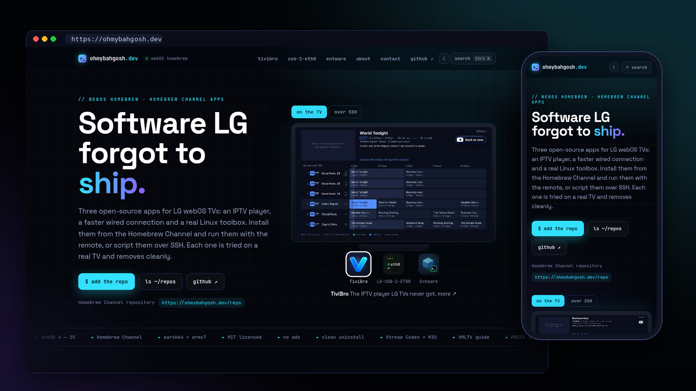

 

**The home of my favorite open-source projects, starting with LG webOS homebrew.**

[**Visit the site**](https://ohmybahgosh.dev) · [Projects](#projects) · [How it's built](#how-its-built)

 

 

## Projects

Every project gets its own page with a live terminal demo, install steps, screenshots and an FAQ.

<table>
<tr>
<td width="33%" valign="top">

### [📺 TiviBro](https://ohmybahgosh.dev/tivibro/)

The IPTV player LG TVs never got.  A free, TiviMate-style player for webOS 4+ with a guide-first layout, catch-up, movies and shows, sports and PPV events, a phone editor and an Android remote.

[Page](https://ohmybahgosh.dev/tivibro/) · [Repo](https://github.com/ohmybahgosh/TiviBro)

</td>
<td width="33%" valign="top">

### [🔌 LG-USB-2-ETH0](https://ohmybahgosh.dev/lg-usb-2-eth0/)

Make a USB Ethernet adapter the TV's `eth0` on rooted LG webOS TVs, so settings and streaming apps use the faster wired link.  Two to three times the built-in port.

[Page](https://ohmybahgosh.dev/lg-usb-2-eth0/) · [Repo](https://github.com/ohmybahgosh/LG-USB-2-ETH0)

</td>
<td width="33%" valign="top">

### [📦 Entware Installer](https://ohmybahgosh.dev/webos-entware-installer/)

One-line Entware for rooted webOS.  Picks the right 64-bit or 32-bit build, test-runs it, survives reboots and uninstalls cleanly.  Comes with `ent`, bash, nano and webOS helpers.

[Page](https://ohmybahgosh.dev/webos-entware-installer/) · [Repo](https://github.com/ohmybahgosh/WEBOS-ENTWARE-INSTALLER)

</td>
</tr>
</table>

## Features

| | |
|---|---|
| ⌨️ **Typed terminal demos** | Every page plays a real session from the project: installs, `status` output, build checks.  They render instantly for visitors who prefer reduced motion. |
| 📈 **Always current** | Versions, release notes, recent commits and stars are pulled from GitHub on every deploy and every 3 hours, so no page needs editing when a project ships. |
| 🔎 **Command palette** | Press <kbd>/</kbd> or <kbd>Ctrl</kbd>+<kbd>K</kbd> (<kbd>⌘</kbd>+<kbd>K</kbd> on a Mac) to jump to any project, section or repo. |
| 🛰️ **Recent activity** | The home page lists the latest releases and commits across the showcased repos. |
| 📝 **Release notes** | TiviBro's page shows a timeline of its newest releases, pulled live from GitHub Releases. |
| ◐ **Light and dark** | A theme toggle in the header, remembered per visitor. |
| 📺 **Homebrew Channel repo** | Add `https://ohmybahgosh.dev/repo` in the Homebrew Channel to install and update the apps.  The repository file is rebuilt from each project's latest release a few times a day (`homebrew/sources.json` lists the projects). |
| ✉️ **Contact templates** | [ohmybahgosh.dev/contact](https://ohmybahgosh.dev/contact/) fills in the right GitHub issue form, discussion or email for bugs, compatibility reports, ideas and questions.  Or write to hello@ohmybahgosh.dev. |
| 📋 **One-tap copy** | Every install command has a copy button that strips comments and prompts. |
| 📱 **Phone first** | Works at 320px wide with no horizontal scroll.  Wide tables scroll on their own. |
| 🔍 **SEO and social cards** | Canonical URLs, Open Graph and Twitter cards with a custom image per page, `schema.org` JSON-LD for each project, a sitemap and robots.txt. |
| 🚫 **No tracking** | No cookies and no ad trackers.  Visits are counted with [GoatCounter](https://www.goatcounter.com), which is privacy-friendly and stores no personal data.  Fonts and screenshots load from jsDelivr. |

## How it's built

Plain HTML, CSS and JavaScript, with no framework and no build step, served by GitHub Pages at [ohmybahgosh.dev](https://ohmybahgosh.dev).  Dark grid background, neon glows and glass cards, set in [Space Grotesk](https://fonts.google.com/specimen/Space+Grotesk) and [JetBrains Mono](https://www.jetbrains.com/lp/mono/).  Each project page has its own accent color.

## License

[MIT](LICENSE).  The projects shown here have their own licenses in their own repos.

 
Made by <a href="https://github.com/ohmybahgosh">OhMyBahGosh</a>.  Not affiliated with LG Electronics.

