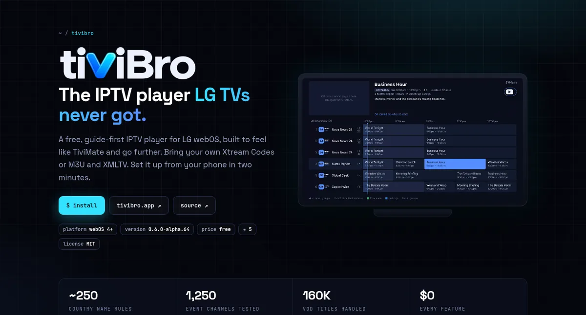
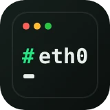
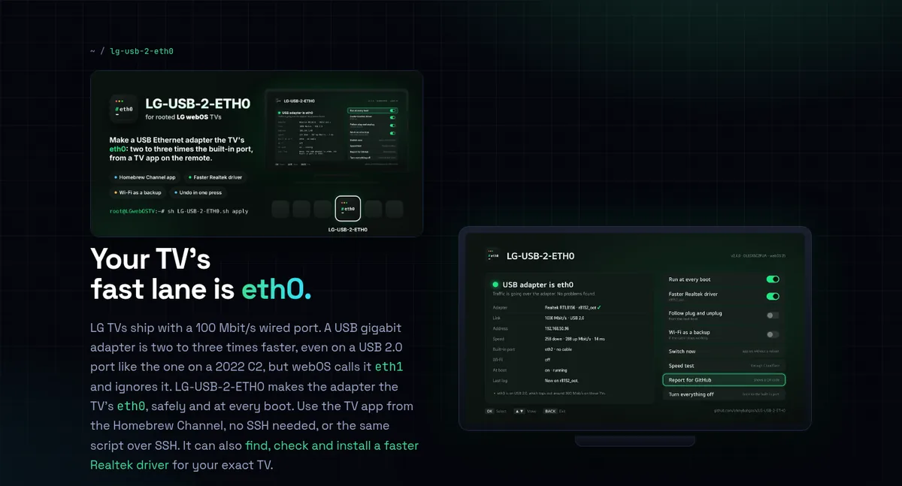
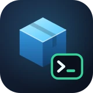
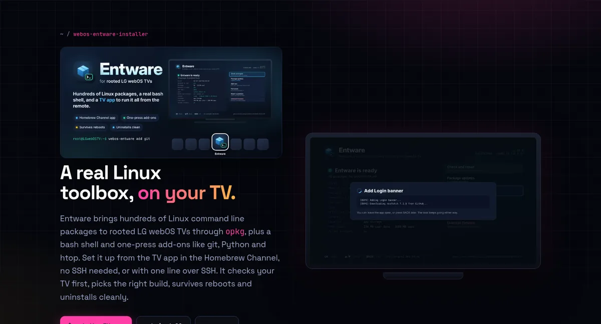
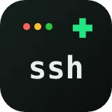
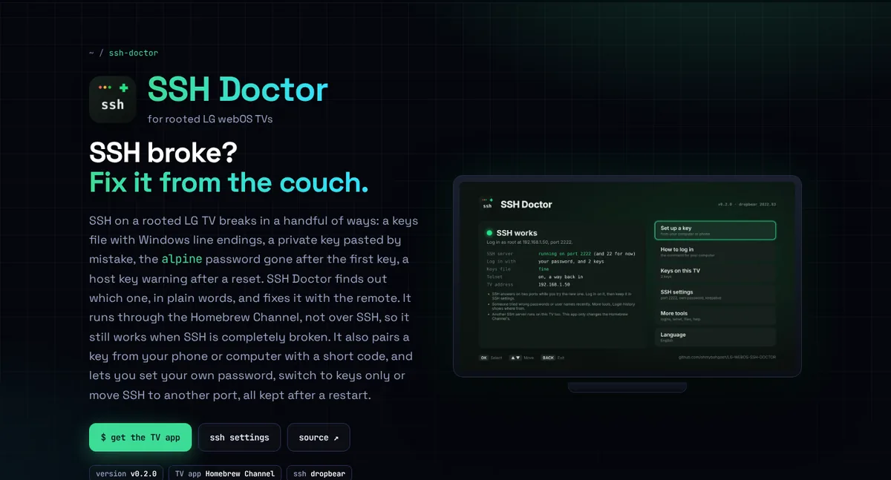

<div align="center">

<a href="https://ohmybahgosh.dev"></a>

<br>

**Homebrew Channel apps for LG webOS TVs, and the home of my favorite open-source projects.**

[](https://ohmybahgosh.dev)
[](https://github.com/ohmybahgosh/ohmybahgosh.dev/actions/workflows/deploy.yml)
[](https://github.com/ohmybahgosh/ohmybahgosh.dev/actions/workflows/links.yml)
[](#install-from-the-homebrew-channel)
[](https://github.com/ohmybahgosh/ohmybahgosh.dev/commits/main)
[](LICENSE)

[**Visit the site**](https://ohmybahgosh.dev) · [Projects](#projects) · [Homebrew Channel](#install-from-the-homebrew-channel) · [On the site](#on-the-site) · [How it's built](#how-its-built)

<br>

<a href="https://ohmybahgosh.dev"></a>

</div>

<br>

## Projects

Four apps for LG webOS TVs.  Each one installs from the Homebrew Channel and runs with the remote, works over SSH too, is tried on a real TV before release, and removes cleanly.  Each has its own page with its banner, a recording of the TV app, install steps, an FAQ and live release notes.

<table>
<tr>
<td width="33%" valign="top">

###  [TiviBro](https://ohmybahgosh.dev/tivibro/)

<a href="https://ohmybahgosh.dev/tivibro/"></a>

The IPTV player LG TVs never got.  A free, TiviMate-style player for webOS 4 and up, for your own Xtream Codes or M3U subscription: a guide-first layout, catch-up, movies and shows, sports and PPV events, a web editor for your phone or computer, and an Android remote.

[](https://github.com/ohmybahgosh/TiviBro)
[](https://github.com/ohmybahgosh/TiviBro/releases)

[Page](https://ohmybahgosh.dev/tivibro/) · [Repo](https://github.com/ohmybahgosh/TiviBro) · [tivibro.app](https://tivibro.app/?utm_source=github&utm_medium=referral&utm_campaign=readme&utm_content=ohmybahgosh_dev_repo)

</td>
<td width="33%" valign="top">

###  [LG-USB-2-ETH0](https://ohmybahgosh.dev/lg-usb-2-eth0/)

<a href="https://ohmybahgosh.dev/lg-usb-2-eth0/"></a>

Makes a USB Ethernet adapter the TV's `eth0`, so settings and streaming apps use the faster wired link: two to three times the built-in 100 Mbit/s port.  It finds, checks and installs a Realtek or ASIX driver for your exact TV, follows plug and unplug, and can keep Wi-Fi as a backup.

[](https://github.com/ohmybahgosh/LG-USB-2-ETH0)
[](https://github.com/ohmybahgosh/LG-USB-2-ETH0/releases)

[Page](https://ohmybahgosh.dev/lg-usb-2-eth0/) · [Repo](https://github.com/ohmybahgosh/LG-USB-2-ETH0)

</td>
<td width="33%" valign="top">

###  [Entware](https://ohmybahgosh.dev/webos-entware-installer/)

<a href="https://ohmybahgosh.dev/webos-entware-installer/"></a>

A real Linux toolbox for rooted webOS: browse 1,100+ packages by category from the remote, a bash shell, package updates and one-press add-ons like git, Python, htop and Tailscale.  Over SSH, `tv` runs the TV and `ent` runs Entware, with Tab completion.  Installs on the TV's roomy app storage, picks the right 64-bit or 32-bit build, survives reboots and uninstalls cleanly.

[](https://github.com/ohmybahgosh/WEBOS-ENTWARE-INSTALLER)
[](https://github.com/ohmybahgosh/WEBOS-ENTWARE-INSTALLER/releases)

[Page](https://ohmybahgosh.dev/webos-entware-installer/) · [Repo](https://github.com/ohmybahgosh/WEBOS-ENTWARE-INSTALLER)

</td>
</tr>
<tr>
<td width="33%" valign="top">

###  [SSH Doctor](https://ohmybahgosh.dev/ssh-doctor/)

<a href="https://ohmybahgosh.dev/ssh-doctor/"></a>

Fixes SSH on a rooted TV from the TV itself, with the remote: a broken `authorized_keys`, a lost `alpine` password, SSH that's off or won't start.  Pairs a key from your phone or computer with a short code, and sets your own password, keys only or another port, kept after a restart.  It runs through the Homebrew Channel, so it works even when SSH doesn't.

[](https://github.com/ohmybahgosh/LG-WEBOS-SSH-DOCTOR)
[](https://github.com/ohmybahgosh/LG-WEBOS-SSH-DOCTOR/releases)

[Page](https://ohmybahgosh.dev/ssh-doctor/) · [Repo](https://github.com/ohmybahgosh/LG-WEBOS-SSH-DOCTOR)

</td>
<td width="67%" colspan="2" valign="top">

Also on the site, and not TV apps so not in the Homebrew Channel repository:

- **[Luna Atlas](https://ohmybahgosh.dev/luna-atlas/)**, a searchable catalog of every LG webOS `luna-send` command (8,125 across 501 services)
- **[pipseek](https://ohmybahgosh.dev/pipseek/)**, a fast PyPI package search CLI

</td>
</tr>
</table>

## Install from the Homebrew Channel

On a rooted LG TV, open the Homebrew Channel, select the gear icon, go to **Repositories**, choose **Add repository** and enter:

```
https://ohmybahgosh.dev/repo
```

All four apps then show up in the Homebrew Channel's app list, and new releases appear there as updates.

| App | What the repository offers |
|:--|:--|
| **TiviBro** | The newest build, including alpha test builds (the same build as `tivibro.app/testing`).  TiviBro's own repositories on tivibro.app keep working too.  Needs webOS 4 or newer. |
| **LG-USB-2-ETH0** | The latest release. |
| **Entware** | The latest release. |
| **SSH Doctor** | The latest release. |

Each entry uses the manifest attached to that project's GitHub release, so the download and its SHA-256 match the release exactly.  On the TV, each app's info page shows a full description with screenshots: [LG-USB-2-ETH0](homebrew/lg-usb-2-eth0.html), [Entware](homebrew/webos-entware.html), [SSH Doctor](homebrew/ssh-doctor.html), and TiviBro's own from tivibro.app.

`/repo` has no file extension, which is what the Homebrew Channel expects, so a browser downloads it instead of showing it.  To read it in a browser, open [ohmybahgosh.dev/repo.json](https://ohmybahgosh.dev/repo.json), an identical copy.

## On the site

| | |
|---|---|
| 📺 **The apps on a TV** | The home page opens on a TV that plays each app in turn, with a dock of their icons.  Tap the TV to open that app's page.  Each project page opens with the project's banner and a recording of its TV app, made on a real LG C2 where there is one. |
| 🧭 **One layout for every project** | Each page follows the same order: banner and video, what it does, its standout feature, the TV app, installing (Homebrew Channel first, then SSH), the details, FAQ, help, and release notes last. |
| ⌨️ **Typed terminal demos** | The SSH sections, and the home page's **over SSH** tab, type out a real session from each project.  They render at once for visitors who prefer reduced motion. |
| 📈 **Always current** | Versions, release notes, recent commits and stars come from GitHub on every deploy.  A new release in any project updates the site and the Homebrew Channel repository within about a minute: the project pings the site, and a check every 15 minutes catches anything missed. |
| 📝 **Release notes** | Every project page ends with a timeline of its newest releases, and the home page lists the latest releases and commits across all of them. |
| 🤖 **How it's built** | The home page says plainly which code is written with AI coding agents, and how it's reviewed, tested and tried on real TVs. |
| 🔎 **Command palette** | Press <kbd>/</kbd> or <kbd>Ctrl</kbd>+<kbd>K</kbd> (<kbd>⌘</kbd>+<kbd>K</kbd> on a Mac) to jump to any project, section or repo. |
| ◐ **Light and dark** | A theme toggle in the header, remembered per visitor. |
| ✉️ **Contact templates** | [ohmybahgosh.dev/contact](https://ohmybahgosh.dev/contact/) fills in the right GitHub issue form, discussion or email for bugs, compatibility reports, ideas and questions.  Or write to hello@ohmybahgosh.dev. |
| 📋 **One-tap copy** | Every install command has a copy button that strips comments and prompts. |
| 📱 **Phone first** | Works at 320px wide with no sideways scrolling.  Wide tables scroll on their own, and every icon is an inline SVG, so none depend on a font having the character. |
| 🔍 **SEO and social cards** | Canonical URLs, Open Graph and Twitter cards with an image per page, `schema.org` JSON-LD for each project, a sitemap and robots.txt. |
| 📊 **Light analytics, no ads** | Visits are counted with [GoatCounter](https://www.goatcounter.com), which is privacy-friendly and stores no personal data, and Google Analytics (GA4), which sets its own first-party cookies.  Google's ads features are switched off, and the site has no ads.  Fonts and TiviBro's screenshots load from jsDelivr. |

## How it's built

Plain HTML, CSS and JavaScript, with no framework.  Dark grid background, neon glows and glass cards, set in [Space Grotesk](https://fonts.google.com/specimen/Space+Grotesk) and [JetBrains Mono](https://www.jetbrains.com/lp/mono/), with an accent color per project.  GitHub Actions publishes it to GitHub Pages at [ohmybahgosh.dev](https://ohmybahgosh.dev).  The only build steps are two small Python scripts, standard library only, that fetch data from GitHub.

```
.
├── index.html                          home page
├── tivibro/  lg-usb-2-eth0/  webos-entware-installer/  ssh-doctor/
│                                       one folder per project page
├── about/  contact/  404.html
├── assets/
│   ├── css/site.css                    every style, design tokens at the top
│   ├── js/site.js                      live data, terminals, palette, tabs, copy, theme
│   ├── js/contact.js                   the contact page's templates
│   ├── img/                            app icons, banners, screenshots and posters (WebP)
│   ├── media/                          TV app recordings (MP4)
│   └── og/                             1200×630 social cards
├── homebrew/
│   ├── sources.json                    which releases go in the Homebrew Channel repository
│   ├── *.html  img/                    app descriptions shown on the TV
├── repo  repo.json                     the Homebrew Channel repository (built, then committed)
├── tools/
│   ├── update-data.py                  writes data/repos.json at deploy time (not committed)
│   └── build-hb-repo.py                writes repo and repo.json from the latest releases
├── docs/                               this README's banner and screenshots
└── CNAME · robots.txt · sitemap.xml · site.webmanifest
```

| Workflow | When | What it does |
|:--|:--|:--|
| [Deploy site](.github/workflows/deploy.yml) | Every push, every 3 hours, on request | Builds `data/repos.json` from GitHub and publishes the site |
| [Homebrew repo](.github/workflows/homebrew-repo.yml) | Four times a day, and when a project releases | Rebuilds `repo` and `repo.json`, commits them if they changed, and redeploys |
| [Watch releases](.github/workflows/watch-releases.yml) | Every 15 minutes | Compares each project's newest tag with the live site and refreshes it if it's behind |
| [Link check](.github/workflows/links.yml) | Every push and pull request, and weekly | Checks every link in the pages and this README |
| [Lighthouse](.github/workflows/lighthouse.yml) | After each deploy | Scores performance, accessibility, best practices and SEO |

Each project repo has a small `notify-site.yml` that pings the site after a release, so updates don't wait for the next scheduled run.

### Add a project

1. Copy a project folder, for example `webos-entware-installer/`, to a folder named after the new repo in lowercase, and keep the same section order.
2. Update the `<title>`, descriptions, canonical URL, Open Graph and Twitter tags, the JSON-LD, and every `data-gh="REPO:field"` attribute so live data points at the new repo.
3. Add its banner, app icon, screenshots and recording to `assets/img` and `assets/media`, and a 1200×630 social card at `assets/og/<folder>.png`.
4. Link it everywhere: a card in the home page's `#repos` grid and its hero dock, the header and footer of every page, the `REPOS` list in `assets/js/site.js`, `tools/update-data.py` and `sitemap.xml`.
5. If it has a TV app, add it to `homebrew/sources.json` with a description page in `homebrew/`.

## License

[MIT](LICENSE).  The projects shown here have their own licenses in their own repos.

<div align="center">
<br>
<sub>Made by <a href="https://github.com/ohmybahgosh">OhMyBahGosh</a>.  Not affiliated with LG Electronics.</sub>
</div>
